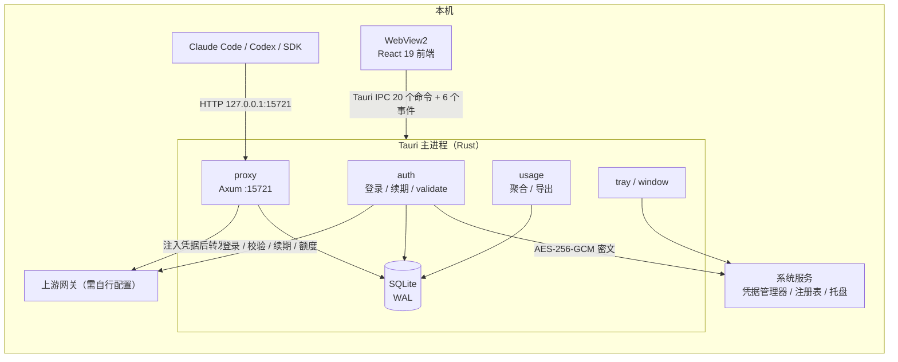

# 总体架构

> 这篇讲应用由哪些进程与模块组成、启动时按什么顺序装配、数据怎么流动；给需要改代码或排查跨模块问题的人看。

## 1. 定位与边界

应用只做三件事，其余一律不做：

| 做 | 不做 |
|---|---|
| 账号登录（浏览器 + 深链回调）与凭据加密保存、自动续期 | Agent 编排、聊天会话、技能/插件市场 |
| 本地 HTTP 代理：把 Anthropic / OpenAI 请求转发到上游网关并注入账号凭据 | 跨协议之外的模型路由决策（由上游网关决定） |
| 用量统计：逐请求 token/费用、日聚合、额度快照、CSV 导出 | 自动更新、定时任务、通知推送 |

它是一个**桌面壳 + 常驻后台服务**：Tauri 主进程里同时跑 WebView2 前端、Axum 本地代理和 SQLite 访问层。关闭窗口不退出进程，代理继续服务。

## 2. 进程与组件



- **前端**（`src/`）：React 19 + Vite，四个页面（登录 / 概览 / 请求 / 设置）。浏览器直开时进入预览模式，全部数据来自 mock（`src/lib/ipc.ts`）。
- **后端**（`src-tauri/src/`）：单一 Rust 进程，Tauri 2 + Tokio + Axum + rusqlite。代理、认证循环、托盘都在这个进程里。
- **数据**：`%USERPROFILE%\.codemaker-hub-light\` 下的 SQLite、`settings.json`、`auth.bin`、`proxy.port` 与 `logs/`。

## 3. 模块地图

| 模块 | 职责 | 关键文件 |
|---|---|---|
| `bootstrap` | 启动装配、阶段计时、后台任务派生 | `bootstrap.rs` |
| `startup` | 启动期致命错误：写日志 + 原生弹窗 | `startup.rs` |
| `logging` / `panic_log` | 按日滚动日志；panic 现场落盘 | `logging.rs`、`panic_log.rs` |
| `shutdown` | 退出埋点：区分正常退出与被外部终止（`session.marker` / `exit.log`） | `shutdown.rs` |
| `state` | 共享状态（设置、凭据、DB、代理）与唯一写入口 | `state.rs`、`settings_store.rs` |
| `auth` | 登录、凭据加密、`/validate`、续期、额度 | `auth/*` |
| `proxy` | HTTP 服务、路由、转发、协议翻译、用量解析 | `proxy/*` |
| `db` | 连接池、迁移、仓储、维护清理 | `db/*` |
| `usage` | 聚合、请求列表、CSV 导出 | `usage/*` |
| `commands` | 20 个 IPC 命令 | `commands/*` |
| `tray` / `window` | 托盘图标与 tooltip、主窗口显示与"关闭即隐藏" | `tray/*`、`window.rs` |
| `deep_link` | scheme 注册、回调监听、二次启动转发 | `deep_link.rs` |
| `compat` | Windows/MSVC 旧工具链的 CRT 链接垫片 | `compat/msvc_crt.rs` |

## 4. 启动时序

`lib.rs::run` 分两段：**建窗前**（失败只能弹窗退出）与 **setup 内**（失败写 `startup-error.log` 并弹窗）。

| 阶段 | 动作 | 失败后果 |
|---|---|---|
| 1 | 解析并创建数据目录 | 弹窗 + `startup-error.log`，进程退出 |
| 2 | 初始化日志（`logs/hub-light.log`，按日滚动） | 降级到 stderr |
| 3 | 安装 panic hook（`logs/panic.log`） | 继续 |
| 4 | 注册插件：单实例 → 深链 → opener | 启动失败 |
| 5 | `bootstrap::init_state`：加载设置 → 打开 DB 并跑迁移 → 组装 `AppState` | 弹窗 + 日志，退出 |
| 6 | 安装托盘 | 视为致命：没有托盘时关闭窗口将无法恢复 |
| 7 | 监听深链回调；scheme 注册丢到线程池（不阻塞） | 仅告警，可用手动粘贴兜底 |
| 8 | 派生后台任务：凭据懒加载、代理启动、保留期清理（启动后一次 + 每 24h） | 记录错误并继续 |
| 9 | 注册 20 个 IPC 命令，进入事件循环 | — |

每个阶段用 `bootstrap::PhaseTimer` 记一行 `phase` / `elapsed_ms`，启动慢时先看这几行日志。

关闭窗口只 `hide`，托盘"退出"先置 `quitting=true` 再 `app.exit(0)`。二次启动由单实例插件接管：聚焦已有窗口、补发 `app://second-instance`、并把深链参数转发给首实例。

## 5. 三条数据流

| 流 | 路径 |
|---|---|
| 登录 | 前端 `auth_start_login` → 浏览器 → 轮询 `auth_poll_status` → 深链回调（或手动粘贴）→ `auth_submit_deep_link` → 凭据加密落盘 → `auth://state` 事件 |
| 代理请求 | 客户端 → 代理路由 → 剥离客户端鉴权头、注入账号凭据 → 按协议翻译/透传 → 上游网关 → SSE 边转发边解析 → 落库 → `proxy://status` 计数 |
| 用量查询 | 前端 `usage_*` 命令 → 读 SQLite（阻塞操作走 `spawn_blocking`）→ 返回聚合结果；额度另经云端接口，落 `quota_snapshots` |

## 6. 必须守住的不变量

1. **设置只有一个写入口**：所有写入经 `SettingsStore::update`；写回后立即更新代理策略（端口与网关除外，需重启代理）。
2. **凭据不落明文**：token 只存在于 Rust 内存与 `auth.bin` 密文；前端、日志、数据库都不出现明文。
3. **登录代次（epoch）**：注销递增代次，所有写入口持写锁校验，旧循环不能把凭据写回来。
4. **代理入口只信回环**：只接受回环 Host；带 `Origin` 的请求一律 403（防浏览器页面读取 `/status` 与额度）。
5. **数据库只加不改**：迁移只做加列/加索引/加事务，不改既有列语义；每步带结构探测，可重入。
6. **本地日唯一**：请求列表与日聚合共用 `usage::local_day` 一个定义。

## 7. 目录结构

```text
src/            React 前端（页面、组件、IPC 封装、测试）
src-tauri/      Rust 后端（Tauri 装配、Axum 代理、SQLite、认证）
  migrations/   SQL 迁移（版本号在 db/mod.rs 中定义）
  tests/        集成测试与 auth fixture
docs/           本套文档
scripts/        公开仓库门禁脚本
```

## 源码索引

- `src-tauri/src/lib.rs`
- `src-tauri/src/bootstrap.rs`
- `src-tauri/src/startup.rs`
- `src-tauri/src/logging.rs`
- `src-tauri/src/panic_log.rs`
- `src-tauri/src/shutdown.rs`
- `src-tauri/src/state.rs`
- `src-tauri/src/settings_store.rs`
- `src-tauri/src/window.rs`
- `src-tauri/src/deep_link.rs`
- `src-tauri/src/tray/mod.rs`
- `src-tauri/src/db/mod.rs`
- `src/lib/ipc.ts`
