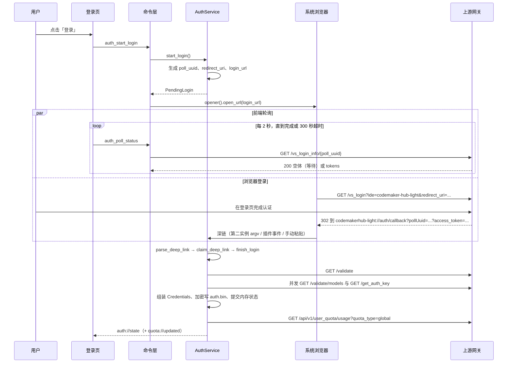

# 认证与登录

> 这篇讲从点击「登录」到凭据加密落盘的完整链路、深链解析的特殊约定、一次性票据与登录代次的约束、三个后台循环的节奏，以及离线宽限和凭据失效的判定差异；给要排查登录问题或改认证代码的维护者看。

## 1. 角色划分

| 角色 | 代码位置 | 职责 |
| --- | --- | --- |
| 登录页 | `src/pages/Login.tsx` | 发起登录、每 2 秒轮询、监听事件、手动粘贴回调链接 |
| 命令层 | `src-tauri/src/commands/auth.rs` | `auth_start_login` / `auth_poll_status` / `auth_submit_deep_link` / `auth_logout` / `quota_get` |
| 认证服务 | `src-tauri/src/auth/service/` | 登录编排、`/validate`、续期、额度、注销、后台循环 |
| 网关客户端 | `src-tauri/src/auth/client.rs` | 所有认证网络请求，20 秒总超时、10 秒连接超时、不跟随重定向 |
| 凭据存储 | `src-tauri/src/auth/store.rs` | `auth.bin` 加解密与系统凭据库主密钥 |
| 深链入口 | `src-tauri/src/deep_link.rs` | scheme 注册、回调监听、第二实例 argv 转发 |

前端可见状态只有五个：`unauthenticated`、`pending`、`authenticated`、`reauth_required`、`error`。后端内部有六个阶段，`OfflineGrace` 对外仍序列化成 `authenticated`（`AuthPhase::frontend_state`）。

## 2. 登录时序



轮询与深链是两条兜底：任一条先完成登录，另一条随后到达会被判为重复而静默忽略。`finish_login` 用 `login_serial` 互斥锁单飞，深链与轮询同时成功时只会做一遍 `/validate` 与落盘。

发起登录的细节（`start_login`）：

- `poll_uuid` 是 `uuid::Uuid::new_v4()`，随响应返回前端；`redirect_uri = codemakerhub-light://auth/callback?pollUuid=<uuid>`。
- `login_url = {gateway}/vs_login?ide=codemaker-hub-light&redirect_uri=<percent_encode(redirect_uri)>`，两个参数都做 RFC 3986 最小百分号编码。
- 网关地址先过 `gateway_url_is_acceptable`：必须 `https://`；`http://` 只允许本机回环，否则返回「网关地址无效」。
- 浏览器唤起失败不报错，`opened_browser=false`，登录页展示链接供复制。

登录完成（`finish_login`）的顺序固定为：`/validate` → 并发取模型目录与续期 key → 组装并加密写盘 → 提交内存状态 → 写账号档案 → 拉额度。额度失败不影响登录，只保留上次快照。

## 3. 深链格式与解析陷阱

上游网关回跳时不是替换 query，而是把 token 追加在已有 `?` 之后，实际形态是两个问号：

```text
codemakerhub-light://auth/callback?pollUuid=<uuid>?access_token=..&access_sso_token=..&access_user=..
```

`parse_deep_link` 因此**不能**用标准 query 解析器：那样第二个 `?` 会连同后面整段成为第一个参数值的一部分，`pollUuid` 被污染。实际做法是按 `&` 和 `?` **同时切分**，逐个 `split_once('=')` 取键值。解析约定：

| 规则 | 行为 |
| --- | --- |
| scheme | 大小写不敏感比较 `codemakerhub-light`，缺失 `://` 或 scheme 不符都拒绝 |
| host/path | 必须是 `auth/callback`（容忍尾斜杠、大小写不敏感） |
| 参数分隔 | 在 `&` 与 `?` 上都切分，空段跳过 |
| 键名别名 | `pollUuid` / `poll_uuid` / `polluuid`；`access_token` / `accessToken` / `token`；`access_sso_token` / `auth_key` / `authkey` / `sso_token`；`access_user` / `user` / `auth_user` |
| 值清洗 | `trim` 后为空丢弃；长度上限 `MAX_TOKEN_LEN`=8192（超出整段丢弃）；含控制字符丢弃；等于占位值丢弃 |
| pollUuid / 用户标识 | pollUuid 必须能解析成 UUID，否则整条深链判无效；用户标识超过 `MAX_USER_LEN`=256 字符时截断而不是报错 |
| 百分号解码 | 只解 `%XX`，不把 `+` 当空格；值里的 `=` 因先 `split_once` 而保留 |
| 占位值 | `unknown_access_token` / `unknown_sso_token` / `unknown_auth_user` 一律视为「没有值」 |

只有 `access_token` 存在才算「带回凭据」（`has_credentials`）；只带 `access_sso_token` 或用户名的深链只做到达确认。

`auth_key` 字段名容易误解：深链里的 `access_sso_token`（225 字符）存进 `DeepLinkPayload.auth_key`，但**不能**当续期 key 用——服务端会以 403 `decrypt auth key fail` 拒绝。真正的续期 key 来自 `GET /get_auth_key`（128 字符），深链值只在取 key 失败时兜底。

深链到达后，事件 `auth://callback` 只携带 `poll_uuid` 与 `has_credentials`；原始 URL 与 token 既不进前端也不进日志，解析失败只写一条 `warn`。

## 4. 一次性票据：pending 绑定与拒绝规则

`claim_deep_link` 是防登录 CSRF 与回调重放的关键闸门，按顺序判定：

| 判定 | 条件 | 结果 |
| --- | --- | --- |
| `NoPending` | 内存里没有进行中的登录 | 不采纳凭据 |
| `Mismatch` | 深链的 `pollUuid` 与 pending 不一致；或带凭据却没有 `pollUuid`（无法证明属于本次登录） | 不采纳 |
| `Expired` | `now - started_at >= POLL_TIMEOUT_SECS`（300 秒） | 不采纳 |
| `Consumed` | 本次 pending 已经采纳过一份随深链带回的凭据 | 不采纳第二次 |
| `Accepted` | 以上都不命中 | 标记 `deep_link_received=true`，带凭据时再置 `credentials_consumed=true` |

处理策略按「是否带凭据」与「是否已登录」分流：

- 重复投递（Windows 上第二实例与插件可能各投一次）：`Consumed` 静默忽略，不提示用户；首次完成流程仍在跑，轮询也能用同一个 `poll_uuid` 兜底。
- 已登录时收到迟到回调（`NoPending` 且 `is_logged_in()` 为真），或不带凭据的迟到回调：都静默忽略；后者仍会把 `deep_link_received` 置真，但不消耗一次性名额。
- 其余被拒：把静态文案写进 `last_error` 并返回 `AuthError::InvalidDeepLink`，不写凭据、不切身份。文案：`NoPending` → 「回调链接不属于当前登录会话（可能已过期或已使用），请点击「登录」重新发起」；`Mismatch` → 「回调链接与当前登录会话不匹配，已忽略」；`Expired` → 「登录会话已超时，请重新点击「登录」」；`Consumed` → 「该回调链接已使用过，已忽略」。

手动粘贴走同一条闸门：`auth_submit_deep_link` 只做解析与转交，token 不回传前端；登录页在提交后立刻清空输入框，链接不再留在前端状态里。

## 5. 登录代次（epoch）

`RuntimeState.epoch: u64` 是登录会话的版本号，注销时 `bump_epoch` 自增，让所有在途操作立刻失效。

写路径纪律只有一种写法：`commit_if_current(epoch, closure)` 在**同一把 `state.write()` 锁内**比较代次并执行闭包，代次不符返回 `None`，闭包不执行。闭包内不允许 `.await`。锁外副作用（写盘、删盘、写库）在执行前用 `still_current(epoch)` 预检，并在代次失配时由调用方补偿：

- `finish_login` 在 `gateway()` 之前先检查一次；写盘后 `commit_login` 若返回 `None`（刚好注销），立刻 `delete_async()` 删掉刚写的文件，绝不复活凭据。
- `persist_profile`、`store_quota` 先 `still_current` 再写，注销后的档案与额度快照不再落库。
- `record_failure` 也走 `commit_if_current`，注销后到达的失败不会把状态改回 `error`。
- 深链完成流程捕获 `SessionEnded` 后保持「已登出」，不覆盖状态。

注销时 `stop_loops` 先发取消信号，等 `LOOP_GRACEFUL_STOP_SECS`=1 秒，超时 `abort` 并仍然 `await` 任务结束；只有本函数返回后才允许删凭据，避免后台循环变成「删完文件又写回去」的游离写者。

## 6. 凭据存储

| 项目 | 事实 |
| --- | --- |
| 文件 | `~/.codemaker-hub-light/auth.bin`（数据目录下的 `auth.bin`），同级 `auth.lock` 做独占锁 |
| 算法 | AES-GCM，256 位密钥（`aes-gcm` crate 的 `Aes256Gcm`），nonce 12 字节随机；AAD 是头部 `CHL1` + 版本号 |
| 字节布局 | offset 0 起 4 字节 `CHL1`、1 字节版本（=1）、12 字节 nonce、其余为密文（含 16 字节 tag） |
| 明文 | `serde_json` 序列化的 `Credentials { access_token, auth_key, user, server_url, issued_at, expires_at }` |
| 主密钥 | 系统凭据库（Windows 为 Credential Manager）：service `codemaker-hub-light`、user `master-key`，内容是 32 字节密钥的 hex |
| 写盘 | `auth.lock` 排他锁内：临时文件 + `sync_all` + `rename` 原子替换；Unix 上权限 `0600` |
| 删除 | `auth.bin` 与主密钥一起删，缺文件/缺条目都当成功 |

不落明文的依据是设计与代码同时满足：`Credentials` 只实现 `Serialize`/`Deserialize` 供加密用，不参与任何 IPC 序列化；`Debug` 把 `access_token` 与 `auth_key` 打印成 `<redacted>`；日志只记录长度与错误分类。

加密不可用时的行为是**明确失败**，不降级：

- `load`：读不到主密钥返回 `StoreError::KeyringMissing`（不会顺手生成新密钥），因此已有 `auth.bin` 解不开。
- 启动时 `load_strict` 把错误写进状态并提示重新登录，应用继续运行；懒加载路径只记录 `last_error`，不打断命令。
- `save` 走 `get_or_create`：首次登录时才创建主密钥；创建失败则整次保存失败。
- 密文被篡改、magic/版本不符、密钥不匹配统一返回 `StoreError::DecryptFailed`，不区分原因以免泄露细节。

## 7. 后台三个循环

`ensure_loops` 只启动一个任务，`run_loop` 的节奏是「先 tick，再等 `RENEW_CHECK_INTERVAL_SECS`」，因此启动后立即检查一轮。tick 内按到期时间分别执行三个动作，只有动作真的发生才继续判断要不要广播。

| 循环 | 检查周期 | 触发条件 | 备注 |
| --- | --- | --- | --- |
| `/validate` | 每 `VALIDATE_INTERVAL_SECS`=600 秒 | `last_validated_at` 为空，或距上次成功 ≥600 秒 | 成功刷新 `last_validated_at`；401/403 先尝试用 `auth_key` 自动续期并重新校验，续期不可用或续期后仍被拒才转 `ReauthRequired`；网络/5xx 转 `OfflineGrace` 且**不**刷新时间戳 |
| 续期 | 每 `RENEW_CHECK_INTERVAL_SECS`=60 秒检查一次 | 距过期 ≤ `RENEW_AHEAD_SECS`=3600 秒，或距上次成功续期 ≥ `RENEW_MAX_INTERVAL_SECS`=82800 秒 | 成功后有 `RENEW_MIN_INTERVAL_SECS`=600 秒静默期；token 已过期时静默期不生效 |
| 额度 | 每 `QUOTA_INTERVAL_SECS`=300 秒 | `last_quota_at` 为空，或距上次成功 ≥300 秒 | 403/404/网络失败都只告警，保留上次快照 |

续期的附加阈值：

| 常量 | 值 | 作用 |
| --- | --- | --- |
| `RENEW_BACKOFF_MIN_SECS` | 60 | 失败退避下限 |
| `RENEW_BACKOFF_MAX_SECS` | 300 | 失败退避上限 |
| 退避序列 | 60 → 120 → 240 → 300 | `next_backoff` 翻倍并封顶 |
| `RENEW_MAX_NO_PROGRESS` | 3 | 连续 3 次「续期成功但过期时间没前进」转 `ReauthRequired` |
| `DEFAULT_TOKEN_TTL_SECS` | 86400 | 服务端未返回 `expire` 时的默认有效期（1 天） |
| `LOOP_GRACEFUL_STOP_SECS` | 1 | 停止循环时给常规退出的宽限窗口 |

续期每轮都会重新 `GET /get_auth_key`（服务端可能轮换，旧记录里也可能存着不可用的 SSO token）；主 key 被 401/403 拒绝时，若已存 key 与主 key 不同则回退重试一次，仍失败才算失败。

### 7.1 token 过期时的自动续期（先续期，再判失效）

后台续期是按「每 60 秒检查一次 + 到期前 1 小时」触发的；如果 token 在两次检查之间被服务端提前失效（例如多端登录顶号、服务端轮换），下一次 `/validate` 会拿到 401/403。此时不再直接要求重新登录，而是走“先续期、再判失效”的分支：

1. 用 `auth_key` 强制续期一次（`renew_now`：跳过"是否到期/静默期"判定，仍走 60s→300s 退避节流）；
2. 续期成功 → 用新 token **重新** `/validate` 一次：
   - 成功 → 回到正常登录态并刷新 `last_validated_at`；
   - 仍 401/403 → `ReauthRequired`（文案「续期后仍被服务端拒绝，请重新登录」）；
   - 网络失败 → `OfflineGrace`（相信刚续到的新凭据）；
3. 续期被拒（401/403）或缺 `auth_key` → `ReauthRequired`；
4. 续期网络/5xx 瞬时失败 → `OfflineGrace`，保留旧凭据等后台重试。

同一条强制续期路径也用于设置页账户面板的手动「重新检测 / 续期」按钮（命令 `auth_retry_renewal`）：成功后补一次 `/validate`，刷新账号档案与模型目录；失败原因写入 `AuthStatus.message`。

其它相关常量：`HTTP_TIMEOUT_SECS`=20（所有认证请求）、`POLL_INTERVAL_SECS`=2、`POLL_TIMEOUT_SECS`=300、`MAX_CONSECUTIVE_NETWORK_ERRORS`=3、`MAX_TOKEN_LEN`=8192、`MAX_USER_LEN`=256。

`update_is_publishable` 决定是否广播 `auth://state`：额度确实更新，或 `AuthStatus` 有任一字段变化才发。状态没变时发事件会让前端整页重拉（24 小时云端曲线也会跟着多打一次网关）。

## 8. 离线宽限与凭据失效的判定差异

判据只有一条：网关错误是否 `is_forbidden()`，即 HTTP 401 或 403。

| 维度 | 离线宽限（`OfflineGrace`） | 凭据失效（`ReauthRequired`） |
| --- | --- | --- |
| 触发 | 网络失败、连接失败、超时、5xx、429、解码失败等非 401/403 错误；或 `/validate` 401/403 但自动续期瞬时失败 | `/validate` 401/403 且自动续期不可用（缺 key/被拒）、续期后重新校验仍 401/403；或续期缺 key；或无进展 3 次 |
| 前端 `state` | `authenticated`（`offline_grace=true`） | `reauth_required` |
| `credentials_valid` | validate 路径不改（沿用原值）；登录时降级则因 `!offline_grace` 写成 `false` | 置 `false` |
| 提示文案 | 「网络异常，已按离线宽限继续」/「自动续期失败（网络异常），已按离线宽限继续」 | 「登录状态已失效，请重新登录」/「续期后仍被服务端拒绝，请重新登录」 |
| 代理转发 | 继续用内存里的旧 token 转发 | `credentials_snapshot()` 返回 `None`，代理直接 401 |
| 后台循环 | 下一轮继续重试 | tick 开头发现 `ReauthRequired` 直接返回，不做无意义重试 |
| 恢复方式 | 任一后续 `/validate` 或续期成功即自动回 `LoggedIn` | 只能重新登录 |

登录过程中 `/validate` 失败也按同一规则分流：403 直接失败（「登录凭据被服务端拒绝（403），请重新登录」），其它错误降级为离线宽限并把登录做完，状态写「登录成功，但 /validate 暂不可用（离线宽限）」，此时账号档案的 `validated_at` 记 `NULL`。

## 9. 注销语义

顺序固定（`logout`）：代次自增 → 停循环并等任务结束 → 删 `auth.bin` 与主密钥 → 清内存状态 → 数据库里把账号档案标记为非激活。

| 清除 | 保留 |
| --- | --- |
| 内存 `credentials`、`profile`、`models`、`pending` | `epoch` 本身（继续作废在途操作） |
| `offline_grace`、`credentials_valid`、`last_error` | 数据库 `auth_profiles` 的历史行（只把 `is_active` 置 0） |
| `last_validated_at`、`last_quota_at`、续期运行时（退避/静默期/无进展计数） | `usage_daily`、请求明细、额度快照、`exports/` 下的 CSV |
| 磁盘 `auth.bin` 与系统凭据库主密钥 | 设置文件、日志、代理端口文件 |

代理的即时反应：`credentials_snapshot()` 在无凭据或 `ReauthRequired` 时返回 `None`，下一次请求走早期失败分支，返回 401 与协议对应的错误体，文案固定为「未登录或登录已失效，请先登录 CodeMaker Hub Light」，`error_kind` 记为 `unauthorized`（用量库里这一行会计入错误数）。

## 10. 失败分类与用户可见提示

| 场景 | 后端状态与文案 | 界面表现 |
| --- | --- | --- |
| 300 秒内没完成登录 | `AuthPhase::Error`，`pending=None`，「登录超时（300 秒），请重试」 | 登录页 `error`，按钮变「重新登录」 |
| 轮询连续 3 次网络错误 | `Error`，「连续 3 次网络错误，登录失败」 | 同上 |
| 轮询单次网络错误 | 保持 `PendingLogin`，「轮询登录状态失败，正在重试」 | 等待态下的非致命提示 |
| 上游返回 401/403 | `Error`，「服务端拒绝该登录请求，请重新发起登录」 | 登录页错误 |
| 上游返回 `credentials_invalid` | `Error`，「服务端返回凭据已失效」 | 登录页错误 |
| 前端命令连续失败 3 次 | — | 前端自行判定失败（`MAX_POLL_FAILURES`=3），避免单次抖动判死 |
| `/validate` 返回 401/403 | 先自动续期并重新校验；续期可用则恢复 `LoggedIn`，不可用才 `ReauthRequired` | 多数情况无感恢复；失败回到登录页 |
| 续期后被重新校验拒绝 | `ReauthRequired`，「续期后仍被服务端拒绝，请重新登录」 | 回到登录页 |
| 手动「重新检测 / 续期」 | 强制续期 + 补 validate；成功回 `LoggedIn`，失败写入 `message` | 账户面板内联提示 |
| 续期被拒 | `ReauthRequired`，「续期被服务端拒绝，请重新登录」 | 回到登录页 |
| 续期缺 key | `ReauthRequired`，「缺少续期凭据（auth_key），请重新登录」 | 回到登录页 |
| 续期无进展 3 次 | `ReauthRequired`，文案说明「自动续期无进展」 | 回到登录页 |
| 续期一般失败 | 保持登录态，「自动续期失败，{n} 秒后重试」 | 状态提示，不打断使用 |
| 额度 403 | `AuthError::Rejected`，「无权限访问用量信息（HTTP 403）」 | 概览页提示「无权限访问额度信息（HTTP 403）」 |
| 额度 404 | `AuthError::Http`，「用量接口不存在，请检查服务版本（HTTP 404）」 | 提示检查网关地址或服务端版本 |
| 额度网络失败 | `AuthError::Http` | 有旧快照时提示「已保留上次成功数据」 |

前端把 `message` 当作唯一的状态说明来源，但登录页只在 `message` 不以「等待浏览器」开头时才当作提示，避免把后端默认的等待文案重复显示。

## 11. 安全边界

- token 不进前端：`AuthStatus` 全量字段不含 token，`DeepLinkPayload`/`CredentialsSnapshot`/`LoginTokens` 的 `Debug` 全部脱敏。
- token 不进日志：只记录长度、状态码与错误分类；错误信息构造时 `reqwest` 的 URL 被剥离。
- token 不进数据库：凭据只存在 `auth.bin` 与 Rust 内存；数据库里只有账号档案与额度快照。
- 不跟随重定向：`redirect::Policy::none()`，避免 `X-Access-Token` 自定义头被带到非预期主机；代理侧遇到上游 3xx 同样拒绝跟随。
- 深链只在 Rust 侧解析与消费：前端只拿到 `poll_uuid` 与「是否带凭据」，手动粘贴的链接提交后立即从前端状态清除。
- 明文 `http://` 网关只对本机回环放行，其余一律拒绝，防止凭据在链路上暴露。
- 注销是安全边界：先停机再删凭据，删除后旧代次的在途写入全部作废。

已知不一致（待验证）：前端 `src/lib/quota.ts` 的额度超时文案写的是「30 秒」，后端认证请求超时是 `HTTP_TIMEOUT_SECS`=20 秒；暂未确认这是历史文案未更新还是另有前端等待上限。

## 源码索引

- `src-tauri/src/auth/mod.rs`、`src-tauri/src/auth/store.rs`、`src-tauri/src/auth/client.rs`
- `src-tauri/src/auth/quota.rs`、`src-tauri/src/auth/hourly.rs`、`src-tauri/src/auth/service/mod.rs`
- `src-tauri/src/auth/service/login.rs`、`src-tauri/src/auth/service/loops.rs`、`src-tauri/src/auth/service/validate.rs`
- `src-tauri/src/auth/service/renewal.rs`、`src-tauri/src/auth/service/quota_flow.rs`
- `src-tauri/src/auth/service/persist.rs`、`src-tauri/src/auth/service/logout.rs`
- `src-tauri/src/deep_link.rs`、`src-tauri/src/commands/auth.rs`
- `src-tauri/src/settings.rs`、`src-tauri/src/bootstrap.rs`
- `src-tauri/src/proxy/credentials.rs`、`src-tauri/src/proxy/routes/errors.rs`、`src-tauri/src/proxy/routes/forward.rs`
- `src/lib/types.ts`、`src/lib/quota.ts`、`src/lib/format.ts`
- `src/pages/Login.tsx`、`src/App.tsx`、`scripts/check-public-repo.mjs`
